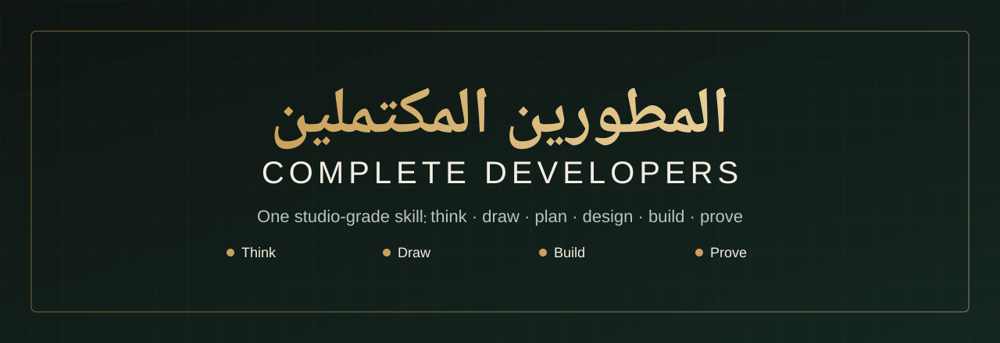

<div align="center">



### One studio-grade skill for AI coding agents.
**Think · Draw · Plan · Design · Build · Prove**, at a fraction of the usual context.

[English](README.md) · [العربية](README.ar.md)


</div>

---

## What it is

**Complete Developers** (المطورين المكتملين) gives any agent that reads `SKILL.md` the habits of a small studio: an architect who decodes what you really asked for, a designer who sketches before building and whose work doesn't look machine-made, an engineer who builds in verified slices, and an auditor who reports evidence instead of confidence. All of it is tuned to spend few tokens.

It is a **workflow**, not a magic prompt. It makes the things strong engineers do silently explicit, cheap and checkable, so mid-size models follow them reliably and strong models skip the ceremony.

## What you get

| Pillar | What it does |
|---|---|
| **Decode** | Turns "make me a site for my restaurant" into a ~120-word **Prompt Card** (goal, audience, must/won't, assumptions, checks). Can also *export* a polished prompt to paste elsewhere. |
| **Draw** | Wireframes (mobile + wide), flows, architecture and state sketches in ASCII, Mermaid or HTML/SVG. In premium work: three structurally different thumbnails, one chosen with a reason. |
| **Plan** | 3–7 vertical slices, each runnable with one check. Riskiest unknown first. |
| **Design (Atelier)** | Human-feeling design: 4 dials, 15 archetypes, a list of generic-design tells to avoid, a two-pass method, a critique protocol, and **contrast-verified tokens** generated by a script. |
| **Build** | Contract-first (reads your lint/commit/format rules), error and security conventions, game and mod notes (Roblox, Bedrock, web), patch mode for vulnerabilities. |
| **Prove** | Evidence ladder and exact status words: *passed / failed / not run / blocked*. High-signal self-review. Security gate. |
| **Thrift** | A 12-part token economy: lanes, progressive loading, repo maps, log trimming, diffs not reprints, a 40-line ledger, stop rules. |
| **Arabic & RTL** | Logical CSS, Arabic typography rules, numerals and bidi, icon mirroring, copywriting, and a workaround guide for engines that don't shape Arabic. |

## Three lanes, so you pay only for what you need

| Lane | When | Cost shape |
|---|---|---|
| **Spark** | one clear edit, a question | core only, a diff, a 3-line reply |
| **Craft** | new feature, vague request, small app | decode → small sketch → slices → checks |
| **Atelier** | visual quality *is* the product, or the user says فاخر / premium | craft + three sketches + design charter + full QA |

## Install

```bash
git clone https://github.com/<your-user>/complete-developers
cd complete-developers
python skills/complete-developers/scripts/install.py --host claude     # or: opencode | agents | codex | gemini | all
```

The installer copies the skill, keeps a timestamped backup of any previous install, and never touches anything else. Useful flags: `--scope project`, `--mode link` (symlink, edits stay live), `--dest <folder>`, `--dry-run`, `--uninstall`.

Manual install: copy `skills/complete-developers/` into your tool's skills folder, then start a new session and mention the skill by name once. Skill folder locations differ between tools and change over time; if yours isn't listed, check its docs and use `--dest`.

Try it:

> Use complete-developers: سو لي موقع لمطعم

## A taste of the output

```
GOAL      visitor sees menu, hours, location and orders in under a minute
WHO/WHERE neighbourhood locals · phone first (390px) · Arabic RTL · static HTML/CSS/JS
MUST      menu with prices, hours, map link, WhatsApp order button (e), gallery (e)
WON'T     online payment, accounts, admin panel
LOOK      Atelier · food-hospitality · boldness 3 · density 2 · motion 2 · warmth 5
DONE WHEN no horizontal scroll at 360px · contrast ≥ 4.5 · every button works or says why not
ASSUMED   sample WhatsApp number (clearly labelled)     UNKNOWN brand colours
```

Then three sketches, a generated charter (colours with measured contrast, type stack, spacing, motion), slices, and a 12-line delivery note. Full walk-through: [examples/01-restaurant-site.md](examples/01-restaurant-site.md).

## Helpers (Python 3, standard library only, no network)

```bash
python scripts/repomap.py .                       # tree + line counts + symbols (Python, JS/TS, Luau, Go, Rust, JVM, …)
python scripts/tokencount.py src --top 10         # estimate what is expensive to read
npm test 2>&1 | python scripts/logtrim.py         # keep the error and its context, fold repeats
python scripts/charter.py --archetype saas-tool --seed "#3B5BDB" --format css
python scripts/contrast.py "#1A1A1A" "#FAF8F3"    # WCAG ratio, exit 1 below AA
python scripts/changelog.py --version 1.2.0       # release notes from Conventional Commits
```

All are read-only. `repomap` withholds secret-like file names (`.env`, keys) and never runs project code.

## How it is organised

```
skills/complete-developers/
├── SKILL.md              core: lanes + the loop (kept under 300 lines)
├── references/           loaded only when the step is reached
│   ├── decode.md  draw.md  atelier.md  arabic-rtl.md
│   ├── build.md   prove.md thrift.md   ship.md  hosts.md
├── scripts/              helpers + installer + self-check
└── assets/               prompt-card, ledger, profile and sketch templates
tests/                    23 unit tests      examples/   worked walk-throughs      evals/   test prompts
```

## Ideas, not code

This skill was designed by studying ten open projects and keeping their *ideas*. No text, data or code was copied; everything here is original wording and implementation.

| Studied | Idea carried over |
|---|---|
| UI UX Pro Max | Reasoning from product type to style/colour/type, tunable design dials, a persisted design system, verify-before-use |
| Anthropic `claude-code` plugins | Distinct design point of view with a plan-then-challenge pass, guided feature phases, high-signal-only review, bounded iteration loops, rules born from corrections |
| shadcn/ui skill | Compose from existing parts, semantic tokens over raw values, rules taught as incorrect/correct |
| commitlint | The repository's configuration is the contract; read it, trust its errors, never bypass |
| GitReleaseManager | Release notes drafted from structured history |
| Node.js Best Practices | Operational vs programmer errors, validated config, layering, boundary validation |
| Astra CLI | CLI contracts: consistent flags, machine-readable output, exit codes, strict validation |
| CC Switch | One source of truth installed to many tools, non-destructive config changes, backups first |
| Automated Code Refactoring & Patching | Structured patch prompts, minimal fixes, never claiming "secure" without evidence |
| Basira Build | Lanes by task difficulty, evidence-first handoff, honest measurement |

## Honest limits

- It cannot make a model smarter; it makes good habits consistent. Results still depend on the model and host.
- Automatic triggering varies by host. Naming the skill once removes doubt.
- Token savings are **not** promised as a number. The habits remove common waste; measure your own tasks (`tokencount.py`, your host's usage view). The numeric budgets are starting heuristics.
- Design taste can't be fully automated. The charter and critique make results consistent and avoid generic tells; a human eye is the last reviewer.
- Folder paths for some hosts follow current conventions and may change; use `--dest` if so.

## Contributing

PRs and archetype ideas welcome: see [CONTRIBUTING.md](CONTRIBUTING.md). Run `python -m unittest discover -s tests -v` and `python skills/complete-developers/scripts/selfcheck.py` first.

## License

[MIT](LICENSE)
