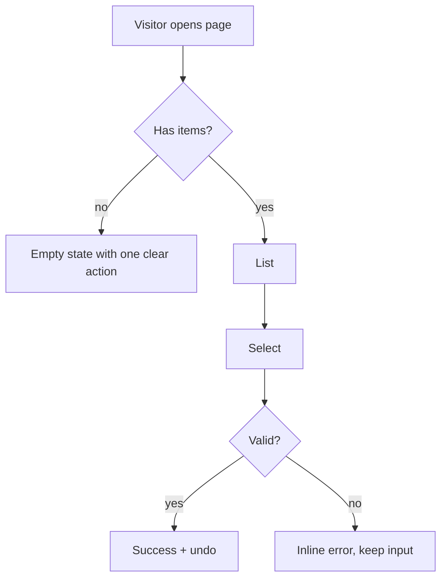
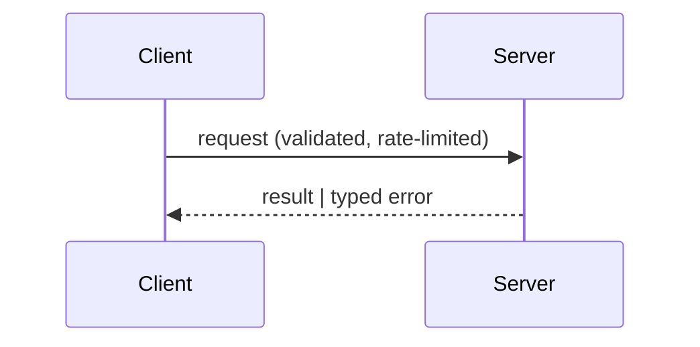
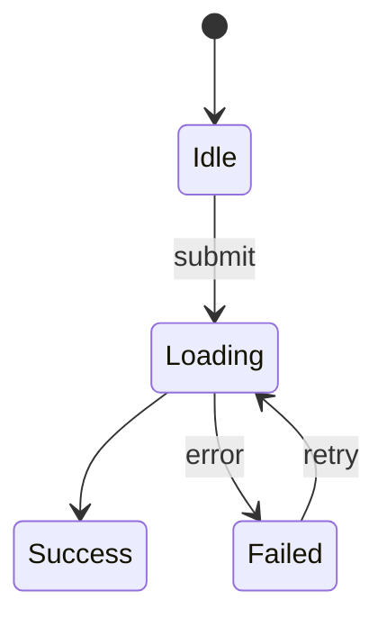

# Draw: think with pictures before you spend tokens on code

Contents: what to draw · budget by lane · ASCII wireframe grammar · layout examples · Mermaid templates · three-thumbnail rule · choosing the medium · review questions

## What to draw, and when

| Drawing | Draw it when | Answers |
|---|---|---|
| **Anatomy** (request map) | The request is vague | What are the parts, who touches them? |
| **Flow** | Branching logic, onboarding, checkout, purchase, auth | What happens on success, empty, error, retry? |
| **Wireframe** | Any new screen or page | Order, primary action, navigation, breakpoints |
| **Architecture** | More than one process, service, client/server split | Boundaries, data direction, trust |
| **State machine** | UI or game state with modes | Which transitions are legal? |
| **Data model** | Storage is involved | Entities, keys, relations |
| **Storyboard** | Animation, onboarding, game feel | Timing and sequence of feedback |

## Budget by lane

- **Spark:** no drawing.
- **Craft:** one flow *or* one wireframe pair (mobile + wide), 10–25 lines each. Skip anything that would not change a decision.
- **Atelier:** anatomy (3 lines) + three wireframe thumbnails + flow for the main journey + the chosen layout at mobile and wide widths.

A drawing exists to remove ambiguity. If nobody would decide differently after seeing it, do not draw it.

## ASCII wireframe grammar

```
┌──────┐  frame / card            [ Button ]   primary action      ( ) radio   [x] checkbox
│      │                          [ ghost ]    secondary           ▾ select    ▒▒▒ image
└──────┘                          ~~~~~~~~     body text lines     ◀ ▶ arrows  ● dot/status
═══════   divider (strong)        ───────      divider (soft)      ⟵ RTL reading direction
```

Label every region with a role, not a decoration ("hero: dish + order button"). Draw the primary action once, visibly. For Arabic or RTL products draw the page mirrored: logo and primary navigation on the right, reading flow right to left, directional icons flipped.

## Layout examples

**Landing, mobile-first (390 px), then wide**
```
 MOBILE                          WIDE (≥1100)
┌──────────────────┐            ┌─────────────────────────────────────────────┐
│ logo        ☰    │            │ logo   nav  nav  nav                [ CTA ] │
├──────────────────┤            ├───────────────────────┬─────────────────────┤
│ ▒▒▒▒ hero ▒▒▒▒   │            │ headline              │  ▒▒▒▒▒▒▒▒▒▒▒▒▒▒▒▒   │
│ headline         │            │ ~~~~~~~ ~~~~~~~       │  ▒▒▒ hero visual ▒▒ │
│ ~~~~~~~~         │            │ [ primary ] ghost     │  ▒▒▒▒▒▒▒▒▒▒▒▒▒▒▒▒   │
│ [ primary ]      │            ├───────────────────────┴─────────────────────┤
├──────────────────┤            │ proof strip (real facts only)               │
│ section 1        │            ├─────────────────────────────────────────────┤
│ …                │            │ section 1 (asymmetric, not 3 equal cards)   │
└──────────────────┘            └─────────────────────────────────────────────┘
```

**Dashboard**
```
┌────┬──────────────────────────────────────────┐
│ ▤  │ title            filters ▾    [ export ] │
│ ▤  ├──────────┬──────────┬──────────┬─────────┤
│ ▤  │ KPI      │ KPI      │ KPI      │ KPI     │
│    ├──────────┴──────────┴─────┬────┴─────────┤
│    │ main chart                │ top list     │
│    ├───────────────────────────┴──────────────┤
│    │ table (sort, page, empty/error states)   │
└────┴──────────────────────────────────────────┘
```

**Game HUD (landscape)**
```
┌────────────────────────────────────────────────────────┐
│ ♥♥♥  score 0420                          coins ● 12 ⏸  │
│                                                        │
│                    play area                           │
│                                                        │
│ [ move stick ]                          [ A ]   [ B ]  │
└────────────────────────────────────────────────────────┘
```

## Mermaid templates

Use when the host renders Mermaid; otherwise keep the same structure in ASCII.







## The three-thumbnail rule (Atelier)

Draw three small layouts that differ on a real axis, not in decoration: *structure* (single column vs split vs grid), *focus* (image-led vs type-led vs interaction-led), *density* (airy vs compact). Name each in four words. Pick one and give the reason in one sentence tied to the audience and the primary action. Do not show all three at full fidelity; the point is to stop yourself shipping the first idea.

## Choosing the medium

1. Host can render an inline visual or artifact: produce a clean SVG/HTML sketch using the charter colours. Keep it low-fidelity so feedback goes to structure, not paint.
2. Host has a file system and browser: write `docs/sketch.html` with inline SVG; open it only if the user can see it.
3. Text only: ASCII plus Mermaid source. Say that it is a sketch, not a render.

Never claim you "looked at" a drawing you only wrote. A drawing you produced is a plan, not evidence of how the final screen looks; check the real render later.

## Review questions before you build

- Where does the eye land first, and is that the primary action or the main content?
- What does the screen show when empty, loading, failed, and full of long text?
- What changes between 360 px and 1280 px, and is the priority order preserved?
- Which element is the one memorable move, and what is deliberately quiet?
- In RTL, which icons and gestures must flip?
